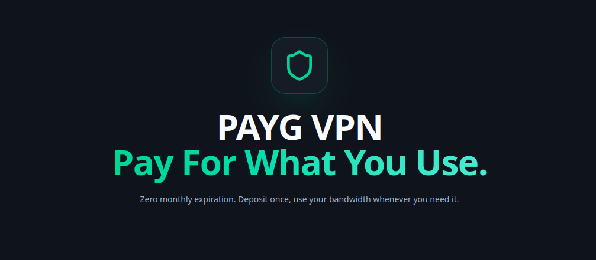

<p align="center">
  
</p>

# PAYG VPN — Web Portal & Single-Page Application (SPA)

<p align="left">
  
  
  
  
  
</p>

The **`web-portal`** is the official modern frontend application for the **PAYG VPN Platform**. Built with **React 19**, **Vite 6**, and **Tailwind CSS 4**, it provides high-concurrency client self-service and administrative management interfaces interfacing directly with the platform's distributed microservices via the central API Gateway.

---

## 📑 Table of Contents

- [Core Capabilities](#-core-capabilities)
- [Workspace Overview](#-workspace-overview)
- [Tech Stack & Dependencies](#-tech-stack--dependencies)
- [Repository Structure](#-repository-structure)
- [Quick Start: Local Development](#-quick-start-local-development)
- [Environment Configuration](#-environment-configuration)
- [Internationalization (i18n) & Theming](#-internationalization-i18n--theming)
- [Production Deployment & Docker](#-production-deployment--docker)
- [Documentation Directory](#-documentation-directory)

---

## 🚀 Core Capabilities

* **🔐 Asymmetric RBAC & Session Security:** Interfaced directly with `iam-service` using secure HttpOnly cookie session management and RS256 token verification.
* **🌍 Native Trilingual Engine (i18n):** Real-time switching across **English (LTR)**, **Persian / Farsi (RTL)** with native `Vazirmatn` font rendering, and **Russian**. Dynamically synchronizes document direction and user profile preferences to backend databases.
* **🌓 Dual-Palette Theming:** Tailored eye-comfort Dark Mode and glare-free Light Mode with persistent cookie memory (`payg_theme`).
* **📈 Dual-Axis 30-Day Telemetry:** Bandwidth consumption (MB/GB) and paid deposit trend visualizations powered by `recharts`.
* **📶 CIDR Subnet ISP Attribution:** Live visual breakdown attributing client data consumption across Iranian and international mobile/fiber carriers (MCI, Irancell, Rightel, Shatel, TCI, Rostelecom, etc.).
* **📱 Universal Subscription & QR Engine:** Dynamic Base64 `/sub/{token}` subscription generation, raw URI copying, and scannable SVG QR codes compatible with `v2rayNG`, `Sing-box`, `Shadowrocket`, `v2rayN`, and `Streisand`.
* **🔄 Self-Service Route Replacement:** Automated blocked route replacement flow with carrier ISP selection and automated NOC support ticket escalation.
* **💬 Real-Time Support Chat:** Threaded ticketing system supporting text, diagnostic logs, and screenshot attachments with Server-Sent Events (SSE) updates.

---

## 🖥️ Workspace Overview

### 1. Client Portal (`/client`)
* **Overview:** Real-time usable wallet balance, gift credits, locked refund amounts, 30-day usage trends, and ISP attribution chart.
* **Servers & Nodes:** Active server nodes with live traffic meters, VLESS/Reality/XHTTP connection URIs, QR codes, and route replacement triggers.
* **Top-Up Wallet:** Multi-channel deposit checkout supporting Shetab card transfers and Crypto (USDT TRC20 / TON) with receipt upload.
* **Payment Histories:** Filterable transaction ledger for top-up verification slips, bank refund tracking, and wallet balance movements.
* **Connection Guides:** Step-by-step installation guides and official download links for Android, iOS, Windows, and macOS.
* **Support / Tickets:** Helpdesk communication with platform administrators.
* **Account Settings:** 12 recovery keys manager, self-service VPN traffic toggle, and Telegram Bot notification linking.

### 2. Admin Portal (`/admin`)
* **Overview:** Platform-wide telemetry, paid revenue metrics (isolated from promotional credits), server fleet health, and pending approvals.
* **Server Fleet Management:** 3X-UI panel connection manager, automatic inbound detection, user limits, and live reachability ping probes.
* **Monitored Users:** User directory with individual 30-day telemetry graphs, manual route reassignment, and gift credit adjusters.
* **Client Top-ups & Refunds:** Audit queue for approving/rejecting manual payment slips and executing client bank refund payouts.
* **Support Helpdesk:** Split-screen ticket triage with quick canned templates.
* **System Logs:** Live audit logs of all outgoing HTTP calls and responses to 3X-UI server panels.
* **System Settings:** Brand identity, global financial rules, safety cutoff thresholds, 3X-UI request timeouts, and maintenance mode.

---

## 🛠️ Tech Stack & Dependencies

| Category | Technology | Version | Purpose |
| :--- | :--- | :---: | :--- |
| **Framework** | [React](https://react.dev/) | `19.0+` | Core frontend user interface |
| **Bundler** | [Vite](https://vitejs.dev/) | `6.2+` | High-speed HMR build toolchain |
| **Language** | [TypeScript](https://www.typescriptlang.org/) | `5.8+` | Strict type safety and compilation |
| **Styling** | [Tailwind CSS](https://tailwindcss.com/) | `4.3+` | Utility-first styling engine with `@tailwindcss/vite` |
| **Routing** | [React Router](https://reactrouter.com/) | `7.18+` | Client-side SPA routing and RBAC route guards |
| **Charts** | [Recharts](https://recharts.org/) | `3.10+` | Dual-axis telemetry and ISP pie charts |
| **Icons** | [Lucide React](https://lucide.dev/) | `0.546+` | Modern iconography |
| **Internationalization** | [i18next](https://www.i18next.com/) | `26.3+` | Multi-language translation engine (EN, FA, RU) |
| **QR Generation** | `qrcode.react` | `4.2+` | Dynamic SVG vector QR code rendering |
| **Animation** | [Motion](https://motion.dev/) | `12.43+` | Fluid transition modals and slide-over drawers |

---

## 📁 Repository Structure

```text
web-portal/
├── src/
│   ├── assets/                 # Fonts (Vazirmatn), graphics, Tailwind CSS entrypoint
│   ├── components/
│   │   ├── common/             # Header, Sidebar, NotificationBox, Modals, QRView
│   │   └── ui/                 # Atomic UI primitives (Buttons, Inputs, StatCards, Badges)
│   ├── contexts/
│   │   ├── AuthContext.tsx     # Session management, JWT decoding, and RBAC state
│   │   ├── ThemeContext.tsx    # Light/Dark theme persistence
│   │   └── SSEContext.tsx      # Server-Sent Events real-time event listener
│   ├── hooks/                  # Custom React hooks (useAuth, useTheme, useTicketPoller)
│   ├── i18n/                   # Translation configuration and locale dictionaries
│   │   └── locales/            # en.json, fa.json, ru.json
│   ├── layouts/
│   │   ├── AdminLayout.tsx     # Sidebar and header wrapper for Administrator views
│   │   └── ClientLayout.tsx    # Responsive shell for Client views
│   ├── pages/                  # Route views (Overview, Servers, Wallet, Support, etc.)
│   ├── routes/
│   │   ├── AppRoutes.tsx       # Application routing tree
│   │   └── ProtectedRoute.tsx  # RBAC route guard
│   ├── services/               # API client, authService, notificationService
│   └── utils/                  # Formatters, token validators, and cookie utilities
├── documentations/             # Complete documentation suite
│   ├── 01-development/         # Local development runbook & architecture
│   ├── 02-i18n-and-theming/    # Translation & theme engine specs
│   ├── 03-features/            # Client & Admin detailed feature specs
│   └── 04-production/          # Production deployment & Nginx build guide
├── Dockerfile.dev              # Local containerized development with hot-reload
├── Dockerfile.prod             # Production multi-stage build (Node 20 -> Nginx Alpine)
├── nginx.conf                  # Production SPA reverse proxy configuration
├── package.json                # Project dependencies and build scripts
└── vite.config.ts              # Vite plugins, path aliases, and backend proxy rules
```

---

## 🚀 Quick Start: Local Development

### Prerequisites
* **Node.js:** `v20.0+`
* **npm:** `v10.0+` (or `bun` / `pnpm`)
* **Running Backend:** Core Services API Gateway operational on `http://127.0.0.1:8000`

### 1. Install Dependencies
```bash
git clone https://github.com/payg-vpn-platform/web-portal.git
cd web-portal
npm install
```

### 2. Configure Environment
```bash
cp .env.example .env
```

### 3. Launch Development Server
```bash
npm run dev
```
*Access Web Portal at: `http://localhost:3000`*

---

## ⚙️ Environment Configuration (`.env`)

```env
# Target API Gateway Address
VITE_API_URL=http://127.0.0.1:8000
VITE_PROXY_TARGET=http://127.0.0.1:8000

# Platform Branding & Locale Defaults
VITE_APP_TITLE="PAYG VPN Portal"
VITE_DEFAULT_LANGUAGE=en
VITE_DEFAULT_CURRENCY=IRT

# Development Port
PORT=3000
```

---

## 🌍 Internationalization (i18n) & Theming

* **RTL Layout Engine:** When switching to Persian (`fa`), the document dynamically toggles `dir="rtl"` and loads the **`Vazirmatn`** font family.
* **Persistent Settings:** Theme (`payg_theme`) and language (`payg_lang`) choices are saved in cookies and synchronized with user account records in `iam_db`.
* **Dual-Currency Formatting:** Financial numbers format automatically according to the user's currency zone (`IRT` in Toman vs `USD` in $).

---

## 🏭 Production Deployment & Docker

### Option 1: Docker Multi-Stage Production Build
Builds the static bundle and serves it via optimized Nginx:
```bash
docker compose --profile production up --build -d
```
*Access at: `http://localhost:3000` (or mapped port `80`)*

### Option 2: Standalone Static Build
```bash
npm run build
# Compiled production bundle is output to /dist
```

---

## 📚 Documentation Directory

Explore the complete technical specifications in the **`/documentations`** folder:

* [📘 **Documentation Index**](./documentations/README.md)
* [💻 **Local Development & Routing Architecture**](./documentations/01-development/README.md)
* [🌍 **i18n Engine & Dual-Theme System**](./documentations/02-i18n-and-theming/I18N_AND_THEMING.md)
* [📱 **Client & Admin Workspace Specifications**](./documentations/03-features/CLIENT_AND_ADMIN_SPECS.md)
* [🏭 **Production Nginx & Multi-Stage Deployment**](./documentations/04-production/PRODUCTION_DEPLOYMENT.md)